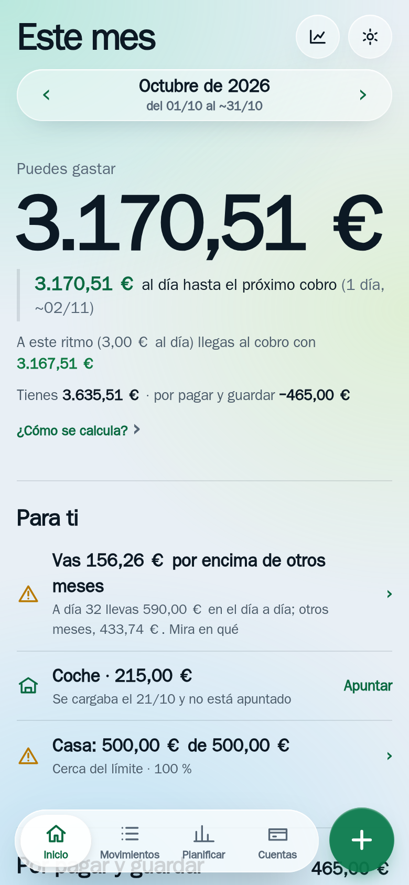
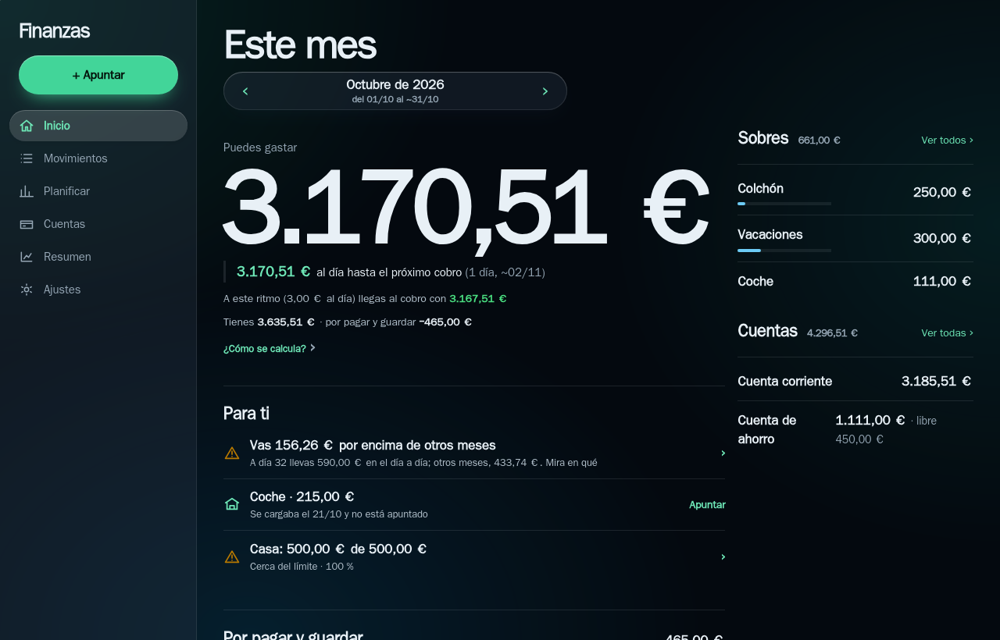
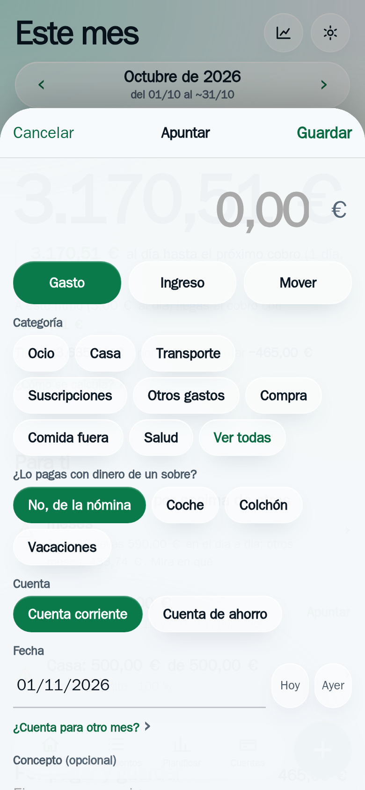
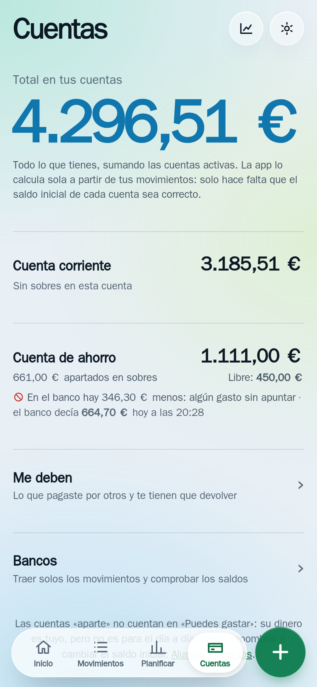

# Finanzas

[](https://github.com/GodoHZ/cuentas-claras/actions/workflows/tests.yml)

App web de finanzas personales **para una sola persona**, pensada primero para el
móvil y para tenerla en casa: un contenedor, una base de datos SQLite y ninguna
cuenta en la nube. Sustituye a la típica hoja de cálculo de gastos.

Dos ideas la sostienen:

- **Cuentas con saldo de verdad**: pones el saldo inicial una vez y la app lo
  calcula sola con tus movimientos. Puedes tener las que quieras (la del día a
  día, la de ahorro, una de comida…) y mover dinero entre ellas con un traspaso.
- **Sobres**: apartas dinero con un nombre («Vacaciones», «Coche») dentro de una
  cuenta y, cuando gastas de ahí, ese gasto no vuelve a restar del dinero libre
  del mes, porque ya lo habías guardado.

| Móvil | Ordenador |
|---|---|
|  |  |

| Apuntar en 5 segundos | Cuentas |
|---|---|
|  |  |

## Qué hace

- **Tu mes va de nómina a nómina**: empieza el día que cobras y acaba el día antes del
  siguiente cobro (o, si lo prefieres, el día 1). Se llama como el mes que cubre casi
  entero: del 28/10 al 27/11 es «noviembre».
- **Inicio**: arranca por lo que **puedes gastar**, que se calcula desde el dinero que
  tienes de verdad (tus cuentas, sin lo apartado en sobres) menos lo que ya está
  comprometido, y cuánto sale **al día hasta el próximo cobro**. Debajo, **Para ti**: solo
  lo que pide que hagas algo (revisar lo del banco, un pago que se carga esta semana, una
  transferencia pendiente al ahorro, un presupuesto que se pasa).
- **Apuntar rápido**: tres tipos —**Gasto**, **Ingreso** y **Mover** (entre cuentas, a un
  sobre o de un sobre)—, las categorías más usadas a un toque y, en un ingreso que no es
  tuyo del todo (el Bizum de un viaje), **«¿Lo apartas en un sobre?»**.
- **Lo que sobra va al ahorro**: lo que te queda en las cuentas el día antes de cobrar se
  guarda solo en el sobre que elijas, y el Inicio te recuerda hacer la transferencia.
- **Planificar**:
  - **Sobres** con meta, con aporte mensual o para algo puntual (cuando lo gastas, te
    ofrece archivarlo). Se crean y se editan desde la propia pantalla.
  - **Presupuesto** solo para el gasto del día a día; los pagos fijos van aparte, solos.
  - **Pagos fijos**: préstamos, seguros y suscripciones, con o sin fecha de fin. Entran en
    lo previsto, y la app sugiere los que se repiten cada mes y aún no están.
- **Cuentas**: saldo de cada una, lo apartado en sobres y lo libre, **cuadre** opcional con
  el banco, y cuáles cuentan para el día a día y cuáles van «aparte».
- **Movimientos del banco, solos**: con [Enable Banking](https://enablebanking.com) (gratis
  para tus propias cuentas), la app trae los movimientos y el saldo cada vez que la abres
  (como mucho cada 15 minutos) y, además, 4 veces al día por su cuenta, que es el máximo
  que permite la normativa europea cuando no estás delante. Lo que ya hubieras apuntado a
  mano se reconoce y no se duplica, un traspaso entre dos cuentas tuyas queda como
  traspaso, los nombres salen limpios («Basic-Fit», no «ADEUDO A SU CARGO // …») y la
  categoría la aprende de ti: lo nuevo llega a la bandeja **Para revisar**, que se vacía
  con un toque por movimiento.
- **A este ritmo**: con lo que gastas al día (últimos 30 días, sin pagos fijos), con cuánto
  llegarás al próximo cobro, o cuánto te faltará.
- **Me deben**: lo que pagaste por otros. Cuando llega el Bizum por ese importe (del banco o
  apuntado a mano), se da por cobrado solo; si hay dudas, mira si el concepto lleva el nombre.
- **Buscador** en Movimientos: en todos los meses, con lo que suma lo encontrado.
- **Reglas del banco**: «si el concepto dice Airbnb → categoría Viajes y sobre Airbnb». Mandan
  sobre lo que la app aprende sola, y se aplican también a lo que esté por revisar.
- **Resumen** de 12 meses, en tabla y en gráfico, y **en qué se va**: lo gastado por categoría
  frente a tu media de los tres meses anteriores.
- **Repartir la nómina**: al cobrar, cuánto va a cada sobre y cuánto queda para el día a día,
  calculado en vivo. Los sobres pueden tener **meta con fecha** («1.200 € para julio»): la app
  dice cuánto guardar al mes para llegar.
- **Retenido en el banco**: los pagos con tarjeta que el banco aún no ha contabilizado ya se
  restan de lo que puedes gastar.
- **Calendario** del mes con lo gastado cada día, los pagos fijos y el cobro.
- **Ritmo del mes**: lo que llevas gastado frente a lo que llevabas otros meses el mismo día.
- **Subidas y cobros dobles**: avisa cuando algo que pagas cada mes sube de precio o se cobra dos veces.
- **Resumen**: tu dinero día a día, el **patrimonio** (lo que tienes menos lo que debes), **cuántos
  meses aguantarías** sin cobrar y **tu año** en números.
- **Etiquetas** para juntar gastos de varias categorías (un viaje, la Navidad) y ver lo que costó todo.
- **Dividir un gasto** entre varios: cada uno queda apuntado en «Me deben».
- **Facturas y tickets**: cada movimiento puede enlazar con su documento de Paperless (con la
  API, la app los propone y deja una nota de vuelta en Paperless).
- **Avisos por Telegram** (opcional): el cierre de cada mes, el resumen de los domingos y, al
  momento, los gastos grandes, los presupuestos que se pasan, las subidas y lo que te devuelven.
- **Qué usas**: Sobres, Presupuesto, Pagos fijos y Bancos se pueden apagar en Ajustes; lo
  apagado desaparece de la app y sus datos se quedan.
- **Copias de seguridad** diarias hechas por la propia app, verificadas y rotadas,
  más exportar a CSV/JSON e importar el CSV de una hoja de cálculo.
- **Dos diseños, un solo código**: barra flotante y botón + en el móvil; menú lateral y
  contenido a varias columnas a partir de 900 px. Aspecto de cristal líquido, en claro y
  en oscuro, que se vuelve sólido con «Reducir transparencia».
- **Funciona sin conexión**: guarda la última versión de cada pantalla para poder
  consultarla, y lo que apuntes sin red se queda en el móvil y se envía solo al
  volver. Cada movimiento lleva un identificador propio, así que un reenvío nunca
  duplica nada. Con el PIN activado no se guarda ninguna copia en el móvil.

Todo está en castellano, en euros y con fechas dd/mm/aaaa.

## Puesta en marcha

```bash
git clone https://github.com/GodoHZ/cuentas-claras.git && cd cuentas-claras
docker build -t finanzas-app:3.3.0 --build-arg VERSION=3.3.0 .
docker compose up -d
```

Y ya está en `http://127.0.0.1:8095`. Al arrancar con la base de datos vacía crea
un esqueleto de categorías, sobres y dos cuentas, **sin ningún movimiento**;
todo eso se cambia desde Ajustes.

Las carpetas `data/` y `backups/` vienen en el repositorio (vacías) para que sean
tuyas y no de root. El contenedor corre como el usuario `1000:1000`; si el tuyo
es otro, cambia esa línea del `docker-compose.yml` por lo que diga `id -u`.

## API (bot de Telegram, Atajos del iPhone)

Si pones la variable `API_KEY`, la app abre una API pequeña con la que otras cosas pueden
apuntar gastos y consultar lo que puedes gastar sin pasar por el PIN. Sin `API_KEY`, no existe.
Todas las llamadas llevan la cabecera `Authorization: Bearer <API_KEY>`.

| | |
|---|---|
| `GET /api/saldo` | `{"puedes_gastar": 123450, "texto": "1.234,50 €", ...}` (importes en céntimos) |
| `GET /api/categorias` | las categorías de gasto activas |
| `POST /api/gastos` | `{"importe": "12,50", "categoria": "comida", "concepto": "opcional"}`: el gasto, hoy, en la cuenta por defecto |

La categoría se busca sin distinguir mayúsculas ni acentos, y vale el principio del nombre
(«super» → «Supermercado»). Se valida igual que el formulario, así que un gasto apuntado por
la API queda exactamente igual que uno apuntado a mano.

## Hasta dónde llega la seguridad

Conviene decirlo claro antes de que la pongas en marcha:

- **No la expongas a internet.** Escucha solo en `127.0.0.1` a propósito. La idea
  es llegar a ella por una VPN (Tailscale, WireGuard) o, como mucho, por un proxy
  inverso con HTTPS dentro de tu red (Nginx Proxy Manager, Caddy, Traefik…).
- **No tiene cuentas de usuario**: es para una persona. Cualquiera que llegue a la
  dirección entra, salvo que actives el PIN.
- **El PIN es una barrera ligera**, no una cerradura: 4 a 8 cifras, guardado con
  PBKDF2 y con un bloqueo de 5 minutos tras 5 intentos. Sirve para que nadie
  cotillee si le dejas el móvil desbloqueado; no para aguantar a alguien decidido.
- **La base de datos no está cifrada.** Quien tenga acceso al fichero, tiene tus
  números. Cífralo desde abajo (disco, LUKS...) si te preocupa.
- **La conexión con el banco** solo puede leer movimientos y saldos de las cuentas a las
  que des permiso; no puede mover dinero. La clave privada se guarda en `SECRETS_DIR`,
  fuera de la base de datos: si tus copias de `DATA_DIR` van a la nube, pon `SECRETS_DIR`
  en otro sitio.
- **Las copias en el móvil** (Ajustes → Sin conexión) se pueden leer sin el PIN,
  porque sin red no hay servidor que lo compruebe. Por eso, con PIN, vienen
  apagadas y la propia app te avisa al activarlas.

Variables del contenedor:

| Variable | Para qué | Por defecto |
|---|---|---|
| `TZ` | zona horaria (los meses y «hoy» dependen de ella) | `Europe/Madrid` |
| `DATA_DIR` | dónde vive `finanzas.db` | `/app/data` |
| `BACKUP_DIR` | dónde van las copias | `/app/backups` |
| `BACKUP_SENTINEL` | fichero que debe existir en la carpeta de copias para escribir en ella | vacío (no comprueba) |
| `APP_VERSION` | se enseña en Ajustes y marca la caché del service worker | `dev` |
| `SECRETS_DIR` | dónde se guarda la clave de la conexión con el banco | `DATA_DIR/secretos` |

`BACKUP_SENTINEL` es para cuando las copias van a otro disco: si ese disco no
está montado, la app **no escribe** en el punto de montaje vacío y avisa, en vez
de dejar ficheros escondidos debajo.

## Las reglas, en corto

- Los importes se guardan **en céntimos** (enteros): nada de decimales flotantes.
- Categorías, sobres y cuentas se referencian **por id**: renombrarlos no rompe el historial.
- **Libre del mes** = ingresos − gastos pagados con la nómina − aportado a sobres.
- Un **gasto pagado desde un sobre** no resta del libre (ese dinero ya estaba
  guardado), pero **sí** cuenta en el presupuesto de su categoría.
- **Saldo de un sobre** = aportes − gastos con ese sobre − retiros.
- **Saldo de una cuenta** = saldo inicial + ingresos − gastos ± traspasos. Un aporte
  a un sobre mueve dinero solo si dices de qué cuenta sale; si no, solo lo aparta.
- **Libre en una cuenta** = su saldo − lo que tienen los sobres que viven en ella.
- **Puedes gastar** = saldo de las cuentas que marques como del día a día − lo que
  tengan apartado en sobres − previsto. Lo que vive en una cuenta que no suma no resta.
- **Previsto** = pagos fijos del mes + aportes mensuales de los sobres, menos lo que ya hayas
  apuntado de cada cosa (y, si ya has cobrado la nómina del mes siguiente, también lo de
  ese mes). Un pago fijo se da por apuntado cuando los gastos de su categoría lo cubren,
  o, si no tiene categoría, cuando pasa su día (van domiciliados).
- **Lo que sobra** = lo que podías gastar el día antes de cobrar; al día siguiente del
  cobro se aparta en el sobre elegido.
- **Cuadre** = lo que dice el banco − lo que calculaba la app **el día de esa
  comprobación** (lo que apuntes después no cuenta como descuadre).
- Lo que tiene movimientos solo se puede **archivar**, no borrar; lo que no se ha
  usado nunca se borra del todo.

Todas viven en `app/calc.py`, que son funciones puras sin base de datos, con sus
tests al lado.

## Cómo está hecho

Python 3.12 + FastAPI + SQLite, plantillas Jinja2 con HTMX y Chart.js para el
gráfico. Sin compilar nada: no hay npm ni bundler.

```
app/
  main.py      arranque (FastAPI), tareas de fondo y la app
  web.py       lo común a todas las pantallas: plantillas, avisos, redirecciones
  rutas/       las pantallas por áreas: inicio, movimientos, cuentas, planificar,
               ajustes, seguridad, datos, pwa, api y bancos
  calc.py      las reglas de cálculo, puras y con tests
  views.py     junta datos y reglas para cada pantalla
  repo.py      consultas SQL          db.py       esquema y conexión
  seed.py      esqueleto inicial      backup.py   copias, rotación y restauración
  importer.py  importador de CSV      export.py   exportar a JSON y CSV
  pin.py       PIN opcional           money.py    céntimos y formato español
  banco.py     movimientos del banco (Enable Banking), sin duplicar nada
  clasificar.py  adivina y aprende la categoría de lo que se apunta solo
  nombres.py   nombres limpios para lo que trae el banco
  avisos.py    el cierre de mes por Telegram
  templates/   pantallas              static/     CSS, JS e iconos
tests/         pytest, se ejecutan dentro del docker build
scripts/       iconos, despliegue en Portainer, capturas con WebKit
```

Los **tests se ejecutan durante `docker build`**: si falla una regla de cálculo,
no llega a generarse la imagen.

Si vas a tocar el código en tu propia copia, hay un hook que impide commitear
datos privados (rutas, dominios, `.db`, ficheros de configuración local):

```bash
git config core.hooksPath scripts/git-hooks
```

La lista de cosas a vigilar se lee de `~/.config/finanzas/patrones-privados.txt`
(una expresión por línea) y no está en el repositorio, por razones obvias.

```bash
docker build --target test -t finanzas-test .        # solo los tests
docker build -f scripts/capturas/Dockerfile --target export \
  --output type=local,dest=/tmp/capturas .           # capturas con WebKit, a tamaño iPhone
```

## Copias de seguridad

La app hace una copia al día con la API de copia en caliente de SQLite (la misma
que `sqlite3 .backup`), la comprueba con `PRAGMA integrity_check` y borra las más
viejas. Desde dentro del contenedor:

```bash
docker exec finanzas python -m app.backup lista
docker exec finanzas python -m app.backup copia
docker exec finanzas python -m app.backup comprobar /app/backups/finanzas-2026-09-20.db
docker exec finanzas python -m app.backup restaurar /app/backups/finanzas-2026-09-20.db /tmp/prueba.db
```

Para restaurar de verdad: parar el contenedor, sustituir `data/finanzas.db` por la
copia (borrando los `-wal` y `-shm`) y volver a arrancar.

## Licencia

MIT.
